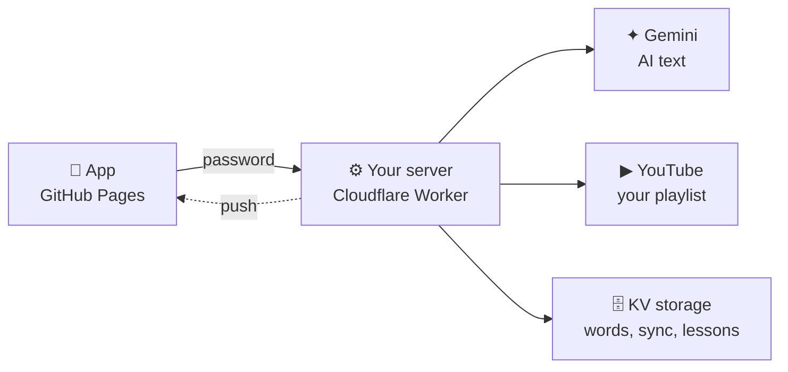

<div align="center">


# Kotoba 言葉

**A small, free Japanese study app: flashcards, daily reading, and shadowing.**

Works on Android, iPhone and PC · installable · works offline · no ads, no accounts

[**Open the app →**](https://tana-jouhou72.github.io/kotoba/)

</div>

---

## What's inside

| Tab | What it does |
|---|---|
| **学 Study** | Anki-style flashcards in two directions: 日本語 → English and English → 日本語. A fixed number of new words a day, plus reviews at growing intervals (Again / Hard / Good / Easy). |
| **読 Read** | A short AI-written lesson in casual, real-life Japanese (LINE chats, SNS posts, conversations…), with key words, casual patterns, questions and a "your turn" writing prompt. |
| **話 Shadow** | One video a day from your YouTube playlist to shadow. An unfinished video continues the next day; a finished one is replaced by a new random video. Includes an AI transcript, sentence repeat and slow speeds. |
| **語 Words** | Add words one at a time or paste many at once. AI fills in the reading, a Japanese definition (意味), nuance and two example sentences. |

Also included:

- 🔔 **Daily reminders** at the times you choose, for the words, the lesson and shadowing.
- 🔄 **Sync** between your phone and computer.
- 📚 **Word lists:** a 122-word N2 starter deck, plus JLPT N5–N1 lists you can add 50 words at a time.
- 🌏 **English or Khmer** translations.

## How it works



- **The app** (`docs/`) is plain HTML, CSS and JavaScript. It keeps your words on the device, so it works offline.
- **The server** (`worker/`) is a small Cloudflare Worker. It handles AI, sync and notifications.
- **Everything runs on free plans:** GitHub Pages, Cloudflare Workers, the Gemini API and the YouTube Data API. No billing is needed.

> 🔒 **No keys in this repo.** API keys and the app password are stored only as secrets in Cloudflare, so the repo can be public.

## Make your own copy

About 25 minutes, all free.

1. **Fork this repo**, then go to **Settings → Pages** and deploy from branch `main`, folder `/docs`. Your app will be at `https://<you>.github.io/kotoba/`.
2. **Get a Gemini API key** at [aistudio.google.com/apikey](https://aistudio.google.com/apikey).
3. **Deploy the server** with a free [Cloudflare](https://dash.cloudflare.com/sign-up) account:
   ```bash
   cd worker
   npx wrangler login
   npx wrangler kv namespace create KOTOBA   # paste the id into wrangler.toml
   npx wrangler deploy
   npx wrangler secret put APP_PASSWORD      # make up a long password
   npx wrangler secret put GEMINI_API_KEY
   ```
4. **Optional, for shadowing:** create a YouTube API key in Google Cloud (enable *YouTube Data API v3*), then run `npx wrangler secret put YOUTUBE_API_KEY`. Your playlist must be **Public** or **Unlisted**.
5. **Open your app → Settings.** Paste the Worker URL and password, tap **Save & test**, install the app to your home screen, and turn on the reminder.

## Tips

- ⌨️ **On PC:** `Space` shows the answer, `1`–`4` grade the card, `H` gives a hint, and `Esc` quits. In Shadow, `Space` plays or pauses, `←` goes back 5 seconds and `R` repeats a sentence.
- 🌙 **The study day rolls over at 4 am**, so studying at 1 am still counts for the day before.
- 💾 **Settings → Export backup** saves a copy of all your words.
- ⏰ **Reminders** arrive within about 5 minutes of the time you set.

## Credits

- JLPT word lists from [open-anki-jlpt-decks](https://github.com/jamsinclair/open-anki-jlpt-decks) (MIT), based on Jonathan Waller's lists at [tanos.co.uk](http://www.tanos.co.uk/jlpt/) (CC BY).
- Fonts: Noto Serif JP, Zen Kaku Gothic New and Noto Sans Khmer from Google Fonts.
- Built with help from Claude.

<div align="center"><sub>頑張って！ 一日一歩。</sub></div>
